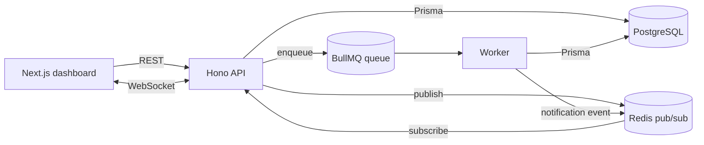

# Pulse: Real-Time Incident Management

Teams report outages, track incidents through their lifecycle, and get live updates and notifications. Built to show backend architecture beyond CRUD: async processing, real-time fan-out, RBAC, and auditability.

**Stack:** Next.js · TypeScript · Hono · PostgreSQL · Prisma · Redis · BullMQ · WebSockets · Docker · Vitest

## Architecture



1. A responder reports an incident or posts an update. The API writes the change, the **incident history entry**, and an **audit log** in **one DB transaction**.
2. After commit, the API publishes an event to **Redis pub/sub** and enqueues a **BullMQ job**.
3. Every API instance subscribes to the channel and fans events out to its connected **WebSocket** clients, so real-time delivery scales horizontally.
4. The **worker** resolves recipients and creates notification rows. It delivers them, retrying with exponential backoff, then pushes a `notification.created` event to each recipient over Redis and WebSocket.

## Features

| Requirement                                       | Implementation                                                                                                                                       |
| ------------------------------------------------- | ---------------------------------------------------------------------------------------------------------------------------------------------------- |
| Real-time status updates and notifications        | Redis pub/sub → WebSocket (`/ws?token=`), live dashboard, toast and bell notifications                                                               |
| RBAC, audit logs, incident history                | `VIEWER` < `RESPONDER` < `ADMIN`; `AuditLog` written transactionally; `IncidentUpdate` timeline with status transitions                              |
| Background jobs with retries and failure handling | BullMQ: 5 attempts with exponential backoff, idempotent delivery (`dedupeKey`), failed jobs kept, audit entry on final failure, admin retry endpoint |
| REST APIs with validation, tests, docs            | Zod validation via `@hono/zod-openapi`, OpenAPI at `/openapi.json`, Scalar UI at `/docs`, Vitest integration tests                                   |

## Quick start

Prerequisites: Node 20+, pnpm, Docker.

```bash
docker compose up -d                 # Postgres + Redis

cd apps/api
cp .env.example .env
pnpm install
pnpm exec prisma generate
pnpm run db:push
pnpm run db:seed
pnpm run dev                         # API on :3001  (docs: /docs)
pnpm run worker                      # in a second terminal

cd ../web
pnpm install
echo NEXT_PUBLIC_API_URL=http://localhost:3001 > .env.local
pnpm dev                             # dashboard on :3000
```

Demo accounts (password `password123`): `admin@pulse.dev`, `responder@pulse.dev`, `viewer@pulse.dev`.

### Everything in Docker

```bash
docker compose --profile app up --build -d
docker compose --profile app exec api pnpm exec tsx prisma/seed.ts
```

## Tests

```bash
cd apps/api
pnpm test
```

Runs against a dedicated `pulse_test` database (created and reset automatically; the suite refuses to run against any other DB). Redis and BullMQ are mocked, so only Postgres is needed. Covers auth, validation, RBAC, transactional history and audit logs, event dispatch, pagination, and admin queue controls.

## API overview

| Method | Path                            | Role       | Purpose                                                            |
| ------ | ------------------------------- | ---------- | ------------------------------------------------------------------ |
| POST   | `/auth/register`, `/auth/login` | public     | Get a JWT                                                          |
| GET    | `/auth/me`                      | any        | Current user                                                       |
| GET    | `/incidents`                    | any        | List (filters: `status`, `severity`, `service`; cursor pagination) |
| POST   | `/incidents`                    | responder+ | Report an incident                                                 |
| GET    | `/incidents/:id`                | any        | Detail with timeline                                               |
| POST   | `/incidents/:id/updates`        | responder+ | Post update / change status / assign                               |
| GET    | `/notifications`                | any        | My notifications                                                   |
| GET    | `/audit-logs`                   | admin      | Audit trail                                                        |
| GET    | `/admin/queue`                  | admin      | Queue counts and failed jobs                                       |
| POST   | `/admin/queue/failed/:id/retry` | admin      | Retry a failed job                                                 |
| WS     | `/ws?token=JWT`                 | any        | Live events                                                        |

Full interactive docs at `http://localhost:3001/docs`.

## Demo failure handling

Set `SIMULATE_FAILURE_RATE=1` in `apps/api/.env`, restart the worker, and report an incident. Watch five retries with growing delays in the worker log, then see the job in **Admin → Job queue**. Set the rate back to `0`, restart the worker, and click **Retry**.

## Design decisions and trade-offs

- **Transactional writes, publish after commit.** State, history and audit can never disagree. If Redis is down, the request still succeeds and publishing failures are logged rather than failing the user's action. A transactional outbox would close that gap fully.
- **Redis pub/sub for fan-out.** Any number of API instances can serve sockets. Pub/sub is fire-and-forget, so clients refetch on reconnect. Redis Streams would add replay.
- **Idempotent notifications.** Retries are safe because each notification has a unique `jobId:userId` key and already-sent rows are skipped.
- **WebSocket auth via `?token=`** because browsers can't set headers on WebSocket. Tokens can appear in server logs. For production, use a short-lived single-use ticket.
- **JWT in `localStorage`** keeps the demo simple. Production would use httpOnly cookies.
- **Roles are coarse** (three levels). Per-team or per-service permissions would be the next step.

## Next steps

Slack/email delivery channels, per-service on-call rotation and escalation, SLA timers, rate limiting, OpenTelemetry tracing, CI pipeline.

## images


